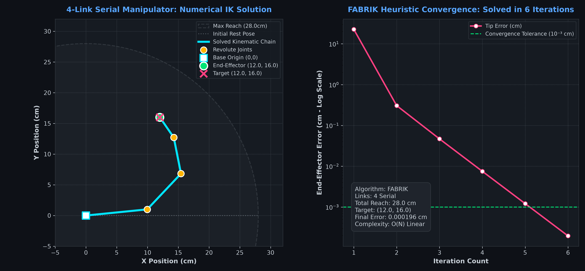

# FABRIK: N-Link Inverse Kinematics Engine 🦾

An iterative, numerical Inverse Kinematics (IK) solver in Python based on the **FABRIK (Forward And Backward Reaching Inverse Kinematics)** heuristic, featuring an interactive **Streamlit** visualization dashboard.

Unlike Jacobian-based inversion methods that suffer from matrix singularity issues and high computational cost, FABRIK solves multi-link kinematic chains with **O(N) linear time complexity** using geometric vector projections.

---

## 📌 Features

- **Arbitrary Chain Lengths:** Solves planar kinematic configurations from 2 links to 100+ serial joints.
- **Fast Convergence:** Converges to sub-millimeter tolerances typically in under 15 iterations.
- **Singularity-Free:** Pure vector operations eliminate matrix inversion failures (no gimbal lock or infinite velocity spikes).
- **Target Reachability Verification:** Immediate geometric bounds check before iterative solving.
- **Interactive Web GUI:** Powered by **Streamlit** and **Matplotlib**, allowing real-time dragging of target points and live telemetry plots.

---

## 📐 How FABRIK Works

FABRIK operates in two alternating geometric stages:

